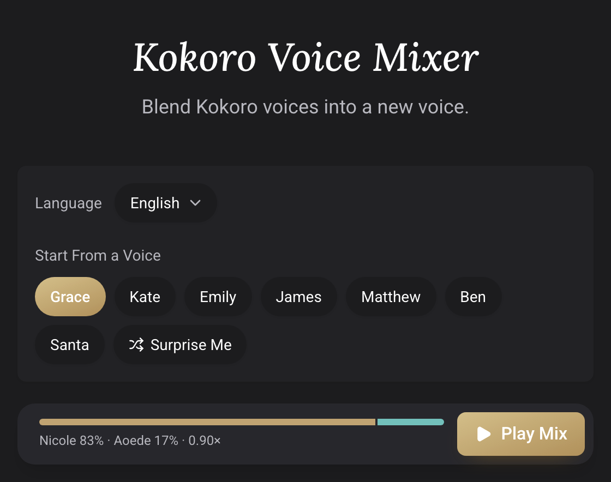

# Kokoro Voice Mixer

Blend [Kokoro](https://huggingface.co/hexgrad/Kokoro-82M) voices into a new voice in your browser, and hear it right away.

<p align="center">
  
</p>

- 54 voices in 8 languages: English (US and UK), Spanish, French, Hindi, Italian, Japanese, Portuguese and Chinese.
- Up to 5 voices per mix, each with its own share, plus a speed.
- Ready-made starting voices, and a Surprise Me button for a random blend.
- Every mix you play is kept as a take. You can replay it, restore its mix or download it as an MP3.
- A link carries the mix, so you can share it.
- The page shows the blend string of your mix, such as `af_nicole+af_aoede(0.2)`. Together AI and Kokoro-FastAPI accept it as the voice.

It is a small Next.js app. The browser never talks to Kokoro directly: one API route sends the text and the blend to a Kokoro server and returns the MP3.

## Run it

You need Node.js 20 or later.

```bash
git clone https://github.com/soundglade/kokoro-voice-mixer.git
cd kokoro-voice-mixer
npm install
cp .env.example .env.local
```

Choose a speech backend in `.env.local` (see below), then:

```bash
npm run dev
```

Open http://localhost:3000.

## Speech backends

The mixer needs a server that runs Kokoro. It supports two. Both speak the OpenAI speech API (`/v1/audio/speech`) and read the same blend strings.

### Together AI

[Together AI](https://www.together.ai/) hosts Kokoro. There is nothing to install, it is fast, and it costs very little per clip.

1. Create an API key at https://api.together.ai.
2. Set it in `.env.local`:

```bash
TOGETHER_API_KEY=your-key
```

### Your own Kokoro

[Kokoro-FastAPI](https://github.com/remsky/Kokoro-FastAPI) runs Kokoro on your machine, with no account and no cost per clip.

1. Start it. With Docker, on a CPU:

```bash
docker run -p 8880:8880 ghcr.io/remsky/kokoro-fastapi-cpu:latest
```

2. Set its address in `.env.local`:

```bash
KOKORO_URL=http://localhost:8880
```

When `KOKORO_URL` is set, the mixer uses it and ignores `TOGETHER_API_KEY`.

The mixer lists the voices of Kokoro v1.0. A voice that your server does not have fails to play. Some Kokoro-FastAPI versions ship without `bf_isabella`, for example.

Any other server works too if it serves `POST /v1/audio/speech` with the model name `kokoro` and accepts blend strings as the voice.

## How blends work

A blend string lists voices joined by `+`, each with an optional weight in parentheses:

```
bm_lewis+am_onyx(0.2)+af_aoede(0.2)
```

- A voice with no weight counts as 1.
- Kokoro divides each weight by their sum, so only the proportions matter. `af_nicole(5)+af_aoede(1)` and `af_nicole+af_aoede(0.2)` are the same voice.
- The first voice is the base voice. It sets the pronunciation rules for the whole mix, because Kokoro picks them from the first letter of its ID (`a` for American English, `b` for British English, `j` for Japanese, and so on). The other voices add their tone. This is why the mixer keeps voices grouped by language, and offers voices from other languages as an extra.
- A single voice is written as its ID alone. Together AI rejects a weight on a single voice.

A link to a mix carries the blend and the speed:

```
http://localhost:3000/?voice=af_nicole+af_aoede(0.2)&speed=0.9
```

## Code

```
src/mixer/voices.ts          The voices, languages, starting voices and sample texts
src/mixer/mix.ts             Reading, writing and editing blends
src/mixer/voice-mixer.tsx    The mixer
src/mixer/voice-picker.tsx   The list of voices to add
src/mixer/clips.ts           Playback, one clip at a time
src/pages/api/speak.ts       The route that asks Kokoro for speech
src/pages/index.tsx          The page
```

```bash
npm test             # Unit tests of the blend logic
npm run type-check
```

## Credits

Kokoro is by [hexgrad](https://huggingface.co/hexgrad/Kokoro-82M). The voice grades that order the voice list come from its [VOICES.md](https://huggingface.co/hexgrad/Kokoro-82M/blob/main/VOICES.md).

## License

[MIT](LICENSE)
